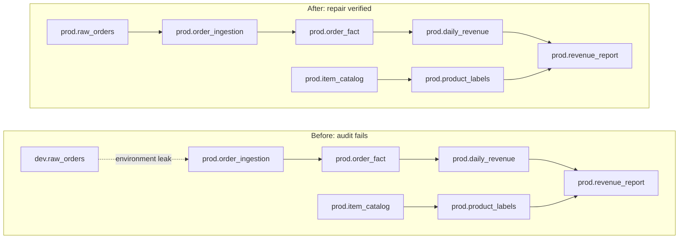
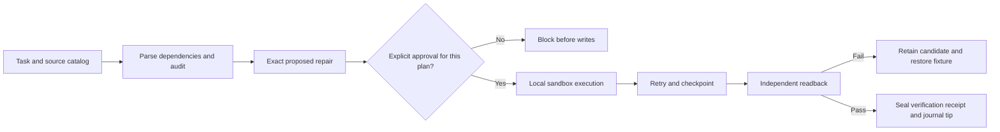

# Governed Agentic Analytics Delivery

A reference workflow for making an analytics change only after its impact and exact repair plan are reviewed. It traces dependencies, blocks unapproved execution, retries bounded failures and verifies the recovered result. The implementation is deterministic Python and SQL on synthetic fixtures; agent roles are architectural guidance.

**Author:** [Amir Ebrahim](https://www.linkedin.com/in/amirebrahim/) | Senior Analytics Engineer

The difficult part of agent-assisted delivery is establishing what changed, why it was allowed and whether it worked. This repository pairs the operating model with executable negative-path tests, content-bound plans, checkpoint recovery and a retained verification receipt.

All platform definitions and datasets are synthetic, and execution changes local sandbox files. No employer code, credentials or private records are included.

## Start here

| Reader | Useful starting point |
|---|---|
| Recruiter or hiring manager | The [before/after dependency view and failure timeline](#what-the-demo-shows) below; the [generated delivery proof](examples/delivery-demo.json) is the raw evidence |
| Analytics engineer | [Eleven SQL checks](scripts/checks.yml), [failure cases](tests/test_negative_path.py), and [SQL lineage](delivery/catalog.py) |
| Data/platform engineer | [Approval and checkpoint implementation](delivery/workflow.py), [integrity checks](delivery/integrity.py), and [delivery tests](tests/test_delivery.py) |

## What the demo shows

The fixture's production-labeled ingestion pipeline reads a development-labeled source, so the revenue report depends on development data. The approved plan changes that one dependency to its production counterpart. The final audit is healthy and reports no affected report.



Each panel leaves out the source not in use: `prod.raw_orders` before the repair and `dev.raw_orders` after it. `prod.product_labels` contains the comment `-- FROM dev.not_a_real_dependency`; the SQL parser ignores it.

The demo then runs that plan through each failure it is built to handle:

| Step | Injected condition | Result |
|---|---|---|
| 1. Execute without approval | No approval | Blocked before any sandbox write |
| 2. Approved repair | Two transient failures | Applied on the third attempt; independent readback passed; `verified` |
| 3. Crash window | Stop after the write, before its checkpoint | `interrupted` with no checkpointed operation |
| 4. Resume | None | Recognized the earlier write from its write-ahead record and expected state; made no new attempt; `verified` |
| 5. Failed verification | An unapproved extra change after the write | Readback failed; the candidate was retained and the working fixture restored to its starting hash; `rolled_back` |

The two verified runs record `cloud_mutations: 0`.

## What works here

| Capability | Demonstration |
|---|---|
| Data correctness | Row counts, key uniqueness/nulls/coverage, referential integrity, values and parent mappings by stable key |
| Dependency analysis | BigQuery-style static SQL with CTEs, aliases, nested queries and comments; transitive impact on report consumers |
| Environment isolation | An invented production-labeled pipeline references a development-labeled source; the audit identifies the affected report |
| Approval binding | An unapproved or changed plan cannot execute; approval covers the exact catalog and dependency changes |
| Bounded execution | Two injected transient failures retry successfully on the third attempt; exhaustion remains partial |
| Crash recovery | A written change interrupted before checkpointing is recognized through its exact write-ahead record and expected state |
| Failed verification | An unapproved extra change fails readback, preserves the failed candidate and restores the working fixture |
| Evidence integrity | Source SHA-256 manifests and a hash-chained journal detect changes against a retained receipt |



## Run it

Python 3.12 or newer. No cloud account or model API key is needed.

```text
python -m pip install -r requirements-dev.txt
python scripts/run_audit.py --demo
python -m delivery demo --output artifacts/demo
python -m pytest -q
```

Use a virtual environment. The demonstration output directory must be new so prior evidence is retained.

The SQL harness passes eleven checks on its clean fixture. The delivery demo first proves that missing approval causes zero sandbox writes. It then shows one environment leak and one affected report, a successful retry, a crash-window recovery and a failed verification that restores the working fixture.

### Inspect the proof

- `artifacts/demo/plan.json`: exact proposed dependency repair and complete before catalog.
- `successful/catalog.json`: corrected working definitions.
- `successful/verified-receipt.json`: approval hash, final catalog hash, independent audit and journal tip.
- `successful/journal.jsonl`: approval check, attempts, applied operation and readback events.
- `resumed/`: recovery after a write occurred before its checkpoint.
- `rollback/`: retained failed candidate, restored fixture and failure journal.
- `source-manifest.json`: exact source-file bytes rather than a file-size-only check.

[The committed example report](examples/delivery-demo.json) was produced by these commands.

## Plan, review and execute separately

```text
python -m delivery audit delivery/fixtures/catalog.json
python -m delivery plan delivery/fixtures/catalog.json --output artifacts/review/plan.json
python -m delivery approve artifacts/review/plan.json --actor demo-reviewer --output artifacts/review/approval.json
python -m delivery execute artifacts/review/plan.json --approval artifacts/review/approval.json --output artifacts/manual-sandbox
python -m delivery verify artifacts/manual-sandbox
```

The first audit exits `1` because the fixture intentionally contains an environment leak. Read the proposed change before approving it. The approval file is a local attestation; the scripted demo labels its approver `synthetic-demo-reviewer`.

## The data-quality harness

The original four-check harness caught row loss, orphan items and null prices, but could miss same-count duplicates, changed prices and an incorrect parent that happened to exist. It now checks:

1. Source/fact row counts at each grain.
2. Item and order key uniqueness, nulls and bidirectional coverage.
3. Orphan order items.
4. Null prices.
5. Item prices and parent IDs against source records by stable key.

The failure suite includes offsetting price errors whose aggregate total remains correct, which is why value-level reconciliation goes beyond row counts and totals. [Twelve harness tests](tests/test_negative_path.py) run clean and corrupted fixtures.

The SQL targets SQLite; `connect()` is the extension point for a warehouse adapter.

## Lineage and impact analysis

[The catalog](delivery/fixtures/catalog.json) describes sources, a pipeline, a fact table, views and a report. View dependencies are parsed with SQLGlot scope analysis, so a CTE name, table alias, comment or string literal is not mistaken for an external source. Declared platform dependencies complete the graph between layers.

Missing assets, unparsed SQL and cycles remain explicit issues and block automatic repair planning. Environment repair uses a unique logical counterpart with the same kind in the target environment; ambiguity fails. SQL reference changes require their own reviewed SQL proposal.

## Agents and the executable boundary

The [role definitions](agents/) and [runbooks](skills/) describe how an investigator, orchestrator, execution role and verifier divide responsibility, independent of any particular agent runtime. The executable code is deterministic Python and SQL; it does not invoke LLMs or contact MCP/cloud servers.

An agent or person can produce a proposal, but execution still needs the exact approved artifact and verification can fail it. See the [routing guidance](docs/model-routing.md).

## Integrity and recovery

The local workflow has a single writer. Atomic working-file replacement, write-ahead events and reconstructed checkpoint state support recovery in the tested crash window. Failed candidates and before-state evidence are retained.

Journal hashes detect edits, reordering, truncation or extra events against the independently retained receipt tip. `delivery verify` also confirms that the retained approved plan, before catalog and approval still hash to the receipt's values.

[Architecture and contracts](docs/architecture.md) cover supported operations and the production adaptation. [Governance](GOVERNANCE.md) distinguishes the local demonstration from the enterprise promotion pattern.

## Repository map

```text
delivery/        static SQL lineage, environment audit, plan/execute/verify and journal
  fixtures/      invented platform definitions
scripts/         independent SQLite data-quality harness and declarative checks
tests/           negative data cases, parser behavior, approval, recovery and integrity
examples/        command-generated demonstration evidence
agents/          conceptual role interfaces for agent-assisted work
skills/          sanitized runbooks
plans/           implementation and illustrative approval artifacts
models/          illustrative dbt-style models
docs/            architecture and model-routing choices
```

Related work: [dbt and BigQuery warehouse](https://github.com/PharaohFresh/analytics-engineering-portfolio) | [query optimizer](https://github.com/PharaohFresh/governed-query-optimizer) | [booking revenue reconciliation](https://github.com/PharaohFresh/revenue-reconciliation-pipeline). [MIT license](LICENSE).
